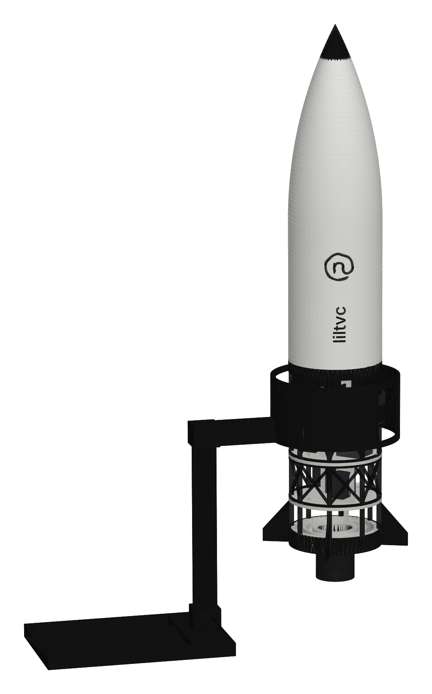
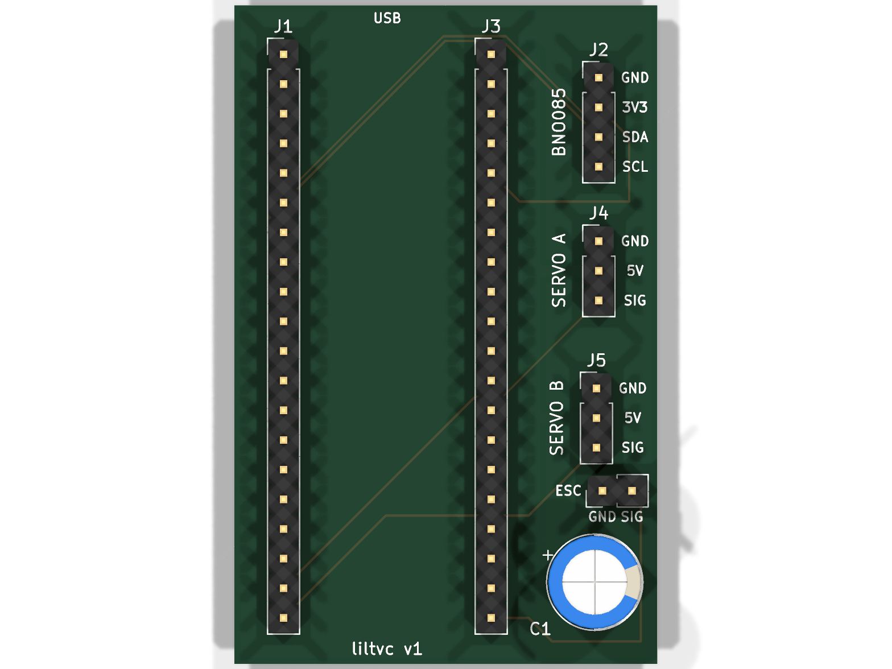
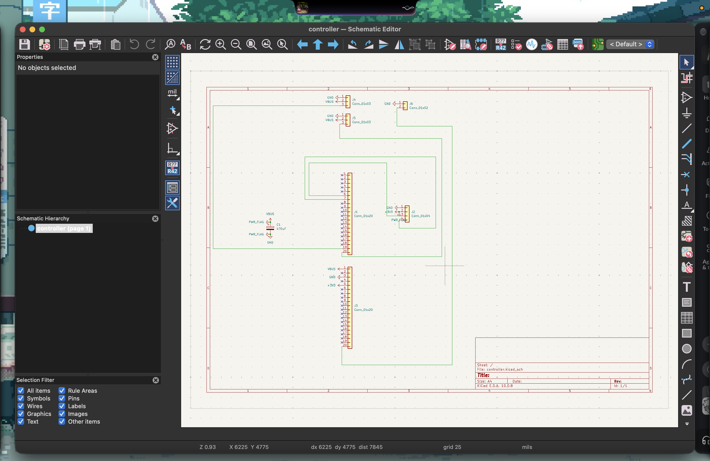

lilpid

a rocket that balances itself. building for hack club fallen (shenzhen, dec 2026)

my project is a self adjusting rocket model using a edf and pid self corectting gimabl movement. it sits on a stand with a pivot, you push it over and the gimbal swings the fan to shove it back upright

how to use

pip install pygame then python main.py, grab the rocket with ur mouse and flick it, the pid catches it
print stuff is in print/ (plates are 3mf, single parts in print/parts), cad is in cad/
pcb gerbers are controller/controller-gerbers.zip, just upload to jlc
parts are in bom.csv

why i made it

i made lilpid since ive always been interested in bps.space, flying, and rocketry, and wanted a excuse for the ridiculously expensive project to come to life

full assembly

pcb

schematic

