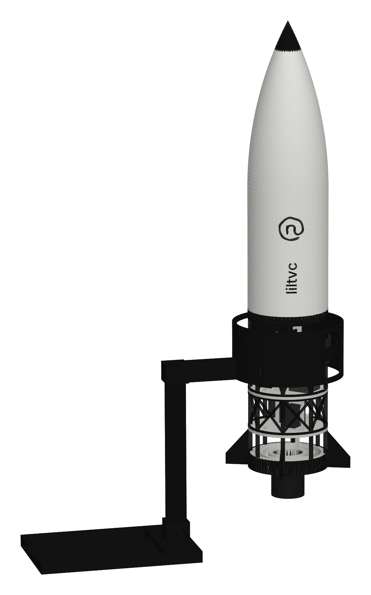
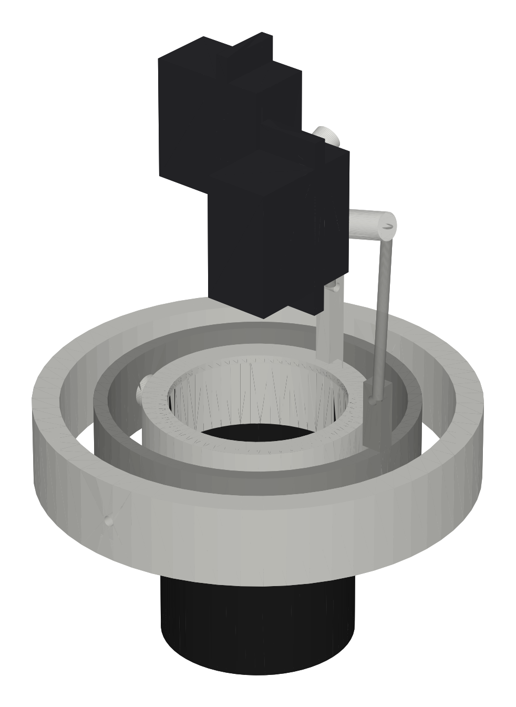
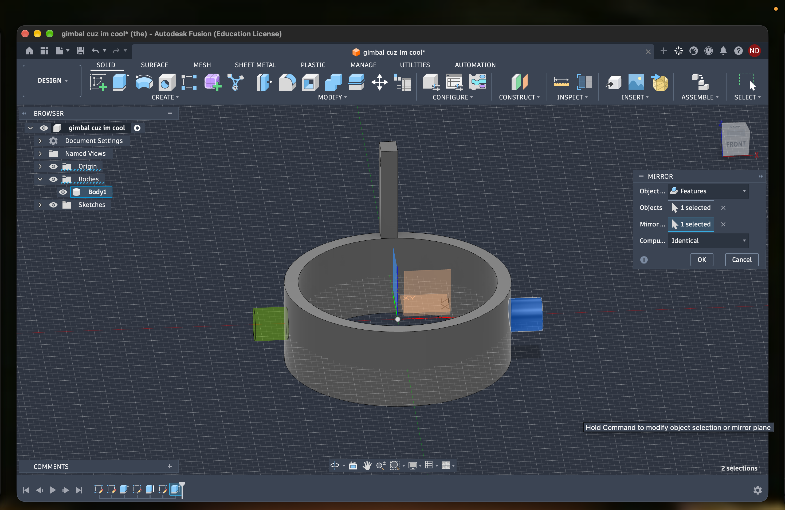
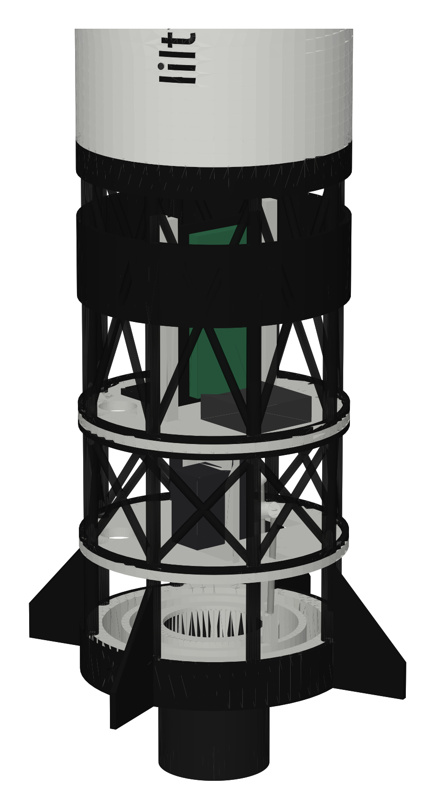
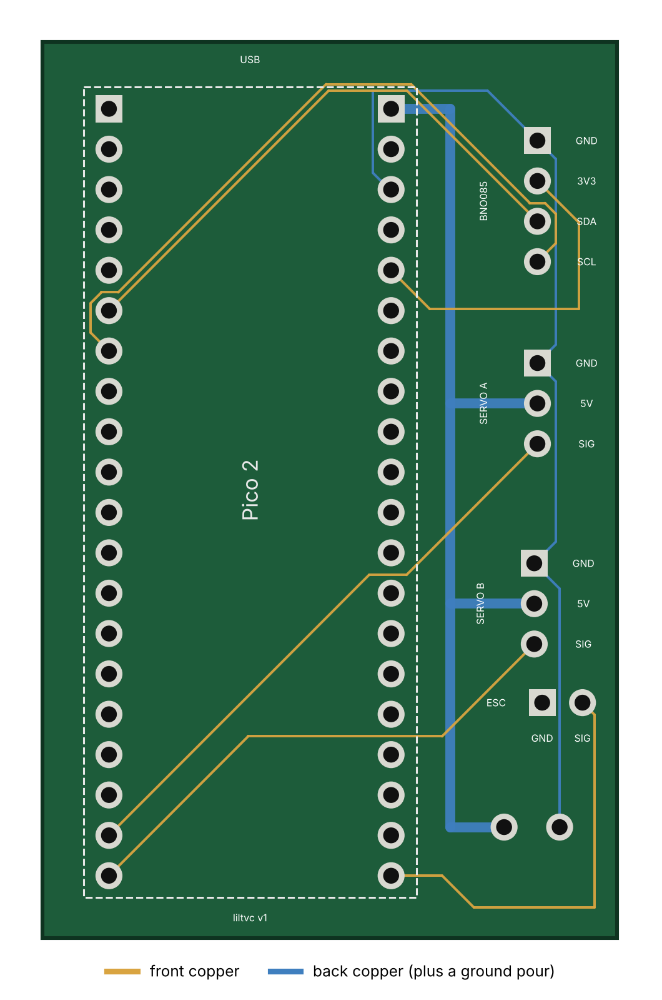
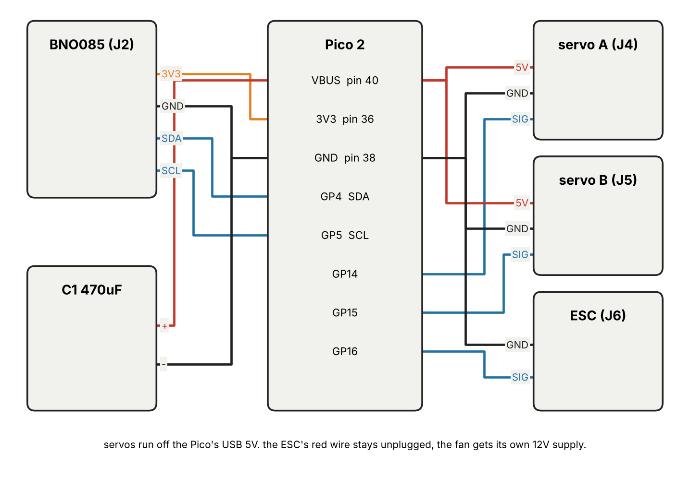

# lilpid

a model rocket that balances itself on a stand. tilt it and a ducted fan in the tail swings to push it back upright, the same way a real rocket steers by pointing its engine (thrust vector control, TVC). building it for hack club fallen (shenzhen, dec 2026).

## how it works

the rocket hangs in a stand that lets it lean any direction, pivoting just below its balance point, so on its own it falls over. inside:

- a BNO085 IMU measures how far it's leaning
- a Pico 2 runs a PD loop on each axis (lean and lean speed in, fan angle out)
- two servos tilt a 30mm ducted fan inside a 2 axis gimbal
- the fan's thrust pushes the tail sideways, which stands the rocket back up

the fan runs off a 12V supply through a small ESC, capped at half throttle with a 45 second timer because the motor is only rated for a minute at full power.

## the gimbal

two rings inside each other on filament pins. the inner ring holds the fan and tilts on one axis, the outer ring carries it and tilts on the other. the servos sit on a deck above and push the ring tabs with ball link rods.

i modelled the gimbal by hand in fusion (first time using it).

the rest of the rocket is open truss bays so you can see everything move: servo bay, then the electronics sled, then the body and nose. the body and stand are parametric cadquery scripts (cad/scripts), and check2.py swings the gimbal through 35 tilt combos up to 20 degrees on both axes to make sure nothing hits and the pushrods never lock.

## pcb

a 36 x 56mm carrier board i drew in kicad. the Pico solders on top, and it breaks out the IMU (J2), both servos (J4, J5) and the ESC signal (J6). names on the back are friends.

| part | Pico pin |
|---|---|
| IMU SDA / SCL | GP4 / GP5 |
| servo A (inner ring) | GP14 |
| servo B (outer ring) | GP15 |
| ESC signal | GP16 |
| servo power | VBUS (USB 5V), 470uF across it |

## using it

1. plug the Pico into USB (power bank or laptop) and the fan into the 12V supply
2. hold the rocket upright for 3 seconds while the ESC arms
3. over serial: `g` starts the fan, `s` stops it, `p` switches between P and PD so you can see what the D term does
4. let go

it prints tilt, fan angle and throttle over serial 20 times a second. without the fan it still works as a hand demo: tilt the rocket and watch the nozzle fight you.

## why

a friend and i want to fly a rocket with real thrust vectoring. that needs a gimbal, a control loop and a flight computer that all work, and a launch gives you one try. this is the version i can poke with a finger a hundred times on a desk. main.py is the pygame sim i learned PID with first: grab the stick with the mouse, flick it, and the two PIDs catch it.

## what's here

- `cad/liltvc.step` full assembly, `cad/gimbal.step` my fusion gimbal, `cad/parts/` a STEP for every printed part
- `print/` STLs, all fit a Bambu A1 mini
- `controller/` kicad project + gerbers
- `firmware/code.py` CircuitPython for the Pico 2 (untested until parts arrive)
- `main.py` the PID sim
- `bom.csv` everything i need to buy, with links

## status

design done, nothing built yet. waiting on parts.
